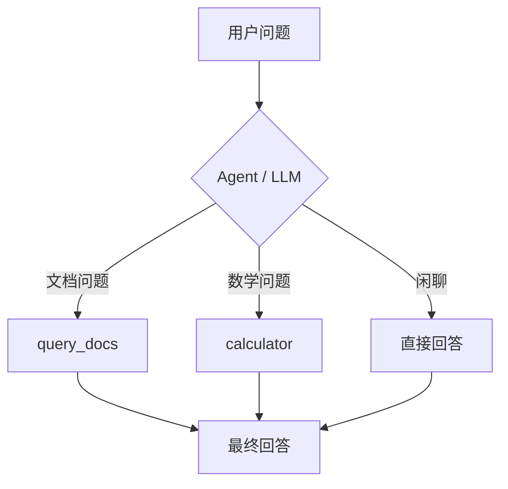

# Hybrid RAG Agent 🔍

基于 **FastAPI + LangChain/LangGraph + ChromaDB** 的**混合检索 RAG 问答 Agent**：BM25 关键词 + 向量语义 + RRF 融合 + LLM ReRank，Agent 自主选择工具（查知识库 / 算数学）。

A hybrid-retrieval RAG Q&A agent built with **FastAPI + LangChain/LangGraph + ChromaDB**: BM25 + vector semantic + RRF fusion + LLM ReRank, with tool calling.

## 特性 / Features

- 🔍 **混合检索** Hybrid Retrieval：BM25 关键词召回 + ChromaDB 语义向量召回
- 🔀 **RRF 融合** Reciprocal Rank Fusion：合并两路结果、去重
- 🧠 **LLM ReRank**：用 DeepSeek 对候选块重排序，只留 Top-K
- 🛠️ **工具调用 Tool Calling**：Agent 自己决定「查知识库」还是「算数学」（v1.1）
- 🤖 **LangGraph 编排**：`create_agent` 构建 ReAct 工具循环
- ⚡ **FastAPI**：`POST /ask` 接口 + 交互式文档

## 目录结构 / Structure

```
hybrid-rag-agent/
├── app/
│   ├── main.py      # FastAPI 入口（/health, /ask）
│   ├── agent.py     # create_agent 工具调用编排（v1.1）
│   ├── tools.py     # 工具集：query_docs + calculator（v1.1）
│   ├── rag.py       # 混合检索引擎（Chroma + BM25 + RRF + ReRank）
│   └── config.py    # 配置（API Key、路径、检索参数）
├── data/            # 原始文档（*.txt）
├── chroma_db/       # ChromaDB 持久化（运行时生成）
├── demo_tools.py        # 工具调用演示脚本（v1.1）
├── tests/               # 冒烟测试（只测 /health）
├── Dockerfile           # 容器镜像
├── docker-compose.yml   # 一键起服务
├── requirements.txt
├── requirements-dev.txt # 测试依赖（pytest + httpx）
└── .env.example         # 环境变量模板
```

## 工具调用 / Tool Calling

Agent 内置两个工具，由 LLM 根据问题内容**自己决定调用哪个**（或都不调用直接回答）：

| 工具 | 作用 | 触发场景 |
|------|------|----------|
| `query_docs` | 查知识库文档（RAG 检索 + 生成） | 文档知识、概念、机制等文档问题 |
| `calculator` | 安全计算数学表达式（`ast` 求值，防注入） | 四则运算、幂、取模等 |



**本地演示 / Try it:**
```bash
.venv\Scripts\python.exe demo_tools.py
```
输出会显示每个问题实际使用了哪个工具（`🛠️ 用：[...]`）。

## 快速开始 / Quick Start

```bash
# 1. 创建虚拟环境（Windows）
python -m venv .venv
.venv\Scripts\activate

# 2. 安装依赖
pip install -r requirements.txt

# 3. 配置 API Key
copy .env.example .env        # 填入 DEEPSEEK_API_KEY

# 4. 启动服务
uvicorn app.main:app --reload

# 5. 测试
curl -X POST http://127.0.0.1:8000/ask ^
  -H "Content-Type: application/json" ^
  -d "{\"question\": \"你的文档问题\"}"
```

API 交互式文档：<http://127.0.0.1:8000/docs>

`/ask` 返回体新增了 `tools_used` / `steps` 字段，可以看到 Agent 每一步调了哪个工具、传了什么参数：

```json
{
  "answer": "计算结果为 1039。",
  "tools_used": ["calculator"],
  "steps": [{ "tool": "calculator", "args": {"expression": "2 ** 10 + 5 * 3"}, "result": "2 ** 10 + 5 * 3 = 1039" }]
}
```

## 效果示例 / Demo

浏览器打开 <http://127.0.0.1:8000/docs>，在 Swagger 界面直接提问：


**示例问答**（实际输出见 docs/demo_qa.md）：

> 问：（你的文档问题）
> 答：见 docs/demo_qa.md

## 检索质量评估 / Retrieval Quality

对 **20** 组覆盖文档多个章节的问答做了命中率（Hit Rate）评估：黄金答案块出现在检索 Top-K 中即命中。评估脚本 `eval_retrieval.py` 可复跑，完整报告见 `docs/RETRIEVAL_EVAL_BGE.md`。

| 指标 | ONNX（英文，旧） | **BGE 中文（新）** | 提升 |
|------|:---:|:---:|:---:|
| Hit Rate@1 | 40.00% | **60.00%** | +20pp |
| Hit Rate@3 | 85.00% | **95.00%** | +10pp |
| Hit Rate@5 | 95.00% | **100.00%** | +5pp |
| MRR | 0.631 | **0.771** | +0.14 |

> 💡 **关键发现（设计权衡）：**
> 1. **中文 embedding 显著更好**：把语义向量模型从英文 `ONNXMiniLM_L6_V2` 换成中文 `BAAI/bge-small-zh-v1.5` 后，**Hit Rate@3 从 85% → 95%，Hit Rate@5 达到 100%**。中文 embedding 对中文文档的语义理解显著更好。
> 2. **LLM ReRank 在此语料上是负优化**（@3 95%→85%）：RRF 融合在小语料下已足够准确，ReRank 的重排噪声反而把正确答案挤出 Top-K。适合 ReRank 的是大语料、候选池大的场景；本项目按候选池大小自适应是否触发。
>
> 完整的踩坑与权衡分析见 [PITFALLS.md](PITFALLS.md)（坑 8：英文 embedding 处理中文；坑 9：ReRank 负优化）。

复跑评估：

```bash
# 默认英文 ONNX（无额外依赖）
.venv\Scripts\python.exe eval_retrieval.py
# 中文 bge（需 sentence-transformers + torch，首次自动下载模型 ~62MB）
EMBEDDING_MODEL=bge .venv\Scripts\python.exe eval_retrieval.py --embed bge
```

## 说明 / Notes

- 默认向量化使用 ChromaDB 内置的本地 ONNX 模型（`ONNXMiniLM_L6_V2`，英文，无需 torch）；**中文语义检索推荐 `EMBEDDING_MODEL=bge`**（`BAAI/bge-small-zh-v1.5`，中文，需 `sentence-transformers` + `torch`）。生成、ReRank 与工具调用走 DeepSeek。
- 两种 embedding 使用独立的 ChromaDB 目录（`chroma_db/` 与 `chroma_db_bge/`），避免向量维度冲突。
- 模型首次运行会下载，之后缓存在本地。
- 踩坑记录见 [PITFALLS.md](PITFALLS.md)。

## 部署 / Deployment

### 方式一：Docker Compose（推荐）

```bash
# 1. 准备环境变量：DEEPSEEK_API_KEY 为必填，缺了应用起不来
copy .env.example .env

# 2. 构建并后台启动
docker compose up -d --build

# 3. 探针
curl http://127.0.0.1:8000/health     # {"status":"ok","kb_chunks":N}
```

交互式文档：<http://127.0.0.1:8000/docs>

### 方式二：直接 docker run

```bash
docker build -t hybrid-rag-agent .
docker run -d --name hybrid-rag-agent --env-file .env -p 8000:8000 ^
  -v chroma_data:/app/chroma_db hybrid-rag-agent
```

### 环境变量

| 变量 | 必填 | 默认 | 说明 |
|------|:---:|------|------|
| `DEEPSEEK_API_KEY` | ✅ | — | 生成与 ReRank 用；**为空时应用启动即报错** |
| `DEEPSEEK_BASE_URL` | | `https://api.deepseek.com` | OpenAI 兼容端点 |
| `DEEPSEEK_MODEL` | | `deepseek-chat` | 模型名 |
| `EMBEDDING_MODEL` | | `onnx` | `onnx`（本地英文 ONNX）/ `bge`（中文，需额外装 torch，本镜像未含） |

### 健康探针

镜像内置 `HEALTHCHECK`，用 Python 标准库请求 `GET /health`（镜像里没有 curl）。
`/health` 返回 `{"status": "ok", "kb_chunks": <块数>}`；只有知识库预热完成后 `kb_chunks` 才非 0，可直接当就绪探针使用。

### 持久化

向量库位于容器内 `/app/chroma_db`，`docker-compose.yml` 已挂载 `chroma_data` 卷，重建容器无需重新切块与向量化。

> ⚠️ **首次运行需要出网**：本地 ONNX 向量模型（`all-MiniLM-L6-v2`，约 79 MB）缓存在宿主机 `~/.cache/chroma/onnx_models/`，容器内是干净的，第一次向量化会自动从 S3 下载。部署环境出网受限时，需预置该缓存目录或改用其他向量化方案。

### 跑测试

```bash
pip install -r requirements-dev.txt
python -m pytest tests/ -q      # 在仓库根目录执行
```

冒烟测试只打 `/health`（验证服务能起、知识库加载成功），**不会**调用 DeepSeek，因此不需要真实 Key；`tests/conftest.py` 会在导入应用前注入一个假 Key。

## Roadmap / 计划

- [x] `create_agent` 接入工具调用（`query_docs` + `calculator`）—— v1.1 ✅
- [x] 检索质量评估：命中率对比（ONNX vs BGE 中文）—— Hit@3 **95%** / Hit@5 **100%** ✅
- [x] 容器化部署配置（Dockerfile / docker-compose）+ `/health` 冒烟测试 ✅
- [ ] 更多领域文档入库
